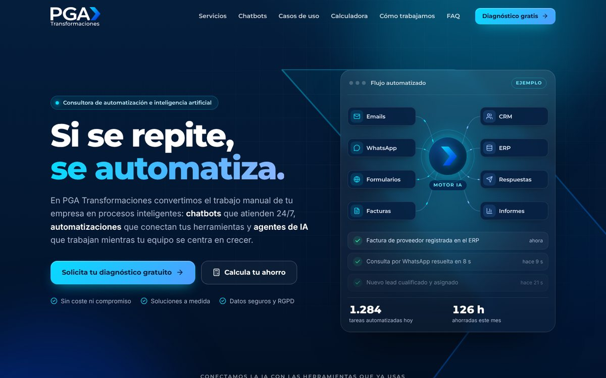

# PGA Transformaciones · Web corporativa

Web de **PGA Transformaciones**, consultora de transformación de procesos y automatización con inteligencia artificial: chatbots, automatizaciones, agentes de IA, lectura de documentos e integraciones.



Es una web estática (HTML, CSS y JavaScript sin dependencias ni paso de compilación), así que se puede publicar gratis en GitHub Pages, Netlify, Vercel o cualquier hosting.

## Qué incluye

La web tiene dos páginas principales:

**`index.html` · portada tipo historia.** Toda la página avanza con el scroll, como una película en 3D:

1. Portada con el chevrón del logotipo en 3D y el mensaje «Si se repite, se automatiza».
2. Llega un aluvión de tareas (emails, facturas, WhatsApp, Excel) y el dato de McKinsey sobre el tiempo automatizable.
3. Las tareas atraviesan el chevrón y salen ordenadas hacia CRM, ERP, clientes e informes.
4. Carrusel con los servicios.
5. Demo de un chatbot que conversa a medida que bajas.
6. Carretera con los 4 pasos del método, recorrida por el chevrón.
7. Vista aérea con los motivos para elegir PGA y llamada al diagnóstico gratuito.

Después de la historia vienen el formulario de contacto y el pie. Un enlace «Saltar al contacto» permite ir directo al formulario. Cada gesto avanza una escena (como en TikTok): un deslizamiento en el móvil, un golpe de rueda o de trackpad en el ordenador, o las flechas del teclado. El chat de la escena 5 se puede usar tocando las respuestas.

**`servicios.html` · todo el detalle.** Servicios, interruptor «Antes / Con PGA», demo interactiva de chatbot (clínica, tienda online e inmobiliaria), casos de uso por departamento, calculadora de ahorro, método, preguntas frecuentes y formulario.

También incluye plantillas de aviso legal y de privacidad y cookies, versión móvil, logotipo en SVG, favicon e iconos, imagen para compartir en redes (`og-image.png`), página 404 y `sitemap.xml`.

## Antes de publicar: lo que falta

La web ya está preparada para el dominio `www.pgatransformaciones.com` (archivo `CNAME`, etiquetas para buscadores y redes, `robots.txt` y `sitemap.xml`).

1. **Email de contacto.** La web usa `info@pgatransformaciones.com` en `index.html`, `aviso-legal.html` y `privacidad.html`. Crea ese buzón en tu proveedor de correo o sustitúyelo por el que vayáis a usar. El formulario envía las solicitudes a la dirección que aparece en la sección de contacto de `index.html`.
2. **Recepción del formulario** (recomendado). Sin configurar nada, el formulario abre el programa de correo del visitante con el mensaje ya escrito. Para recibir las solicitudes directamente:
   - Crea un formulario gratuito en [Formspree](https://formspree.io) (u otro servicio similar).
   - Copia la URL que te dan (por ejemplo, `https://formspree.io/f/abcdwxyz`) en `formEndpoint`, al principio de `js/main.js`.
   - Añade ese proveedor en el apartado «Destinatarios» de `privacidad.html`.
3. **WhatsApp** (opcional). Escribe vuestro número en `whatsapp`, al principio de `js/main.js` (con prefijo y sin espacios, por ejemplo `34600123456`) y aparecerá un botón flotante.
4. **Datos legales.** Rellena los campos resaltados en amarillo de `aviso-legal.html` y `privacidad.html` (razón social, NIF, domicilio…) y haz que los revise vuestra asesoría.
5. **Revisa los textos comerciales.** Algunos compromisos son propuestas que debéis confirmar: el diagnóstico gratuito de 30 minutos, las respuestas de la FAQ, la lista de herramientas con las que os integráis y los ejemplos de la demo (precios, horarios, etc.).

## Verla en tu ordenador

Abre `index.html` con el navegador. Para que todo funcione igual que en Internet, mejor con un pequeño servidor local:

```bash
python3 -m http.server 8000
```

y visita `http://localhost:8000`.

## Publicarla en GitHub Pages

1. Une esta rama a `main` (o publica directamente desde la rama que prefieras).
2. En GitHub, ve a **Settings → Pages**.
3. En «Build and deployment», elige **Deploy from a branch**, la rama `main` y la carpeta `/ (root)`.
4. En uno o dos minutos la web estará en `https://<usuario>.github.io/<repositorio>/`.
5. Para usar vuestro dominio, añádelo en **Custom domain** y crea en tu proveedor de dominio los registros DNS que indica GitHub.

## Estructura

```
index.html            Portada tipo historia (animación 3D con scroll)
servicios.html        Página con todo el detalle de servicios, calculadora y FAQ
aviso-legal.html      Plantilla de aviso legal
privacidad.html       Plantilla de política de privacidad y cookies
404.html              Página de error
css/styles.css        Estilos (colores de marca en las variables del principio)
js/main.js            Interacciones y configuración (formulario, WhatsApp)
js/story.js           Animación 3D de la portada (avanza con el scroll)
assets/vendor/three/  Librería three.js para la animación 3D (licencia MIT)
assets/img/           Logotipos SVG, favicon, iconos e imagen para redes
assets/fonts/         Tipografías Montserrat e Inter (licencia OFL)
assets/brand/         Logotipo original en JPG
```

## Detalles técnicos

- **Colores de marca**, sacados del logotipo: azul marino `#041E3C`, cian `#05DBFF` y azul `#0046E2`.
- **Logotipo vectorial** recreado a partir del JPG original con la tipografía Montserrat. Si vuestro diseñador tiene el logotipo original en SVG, AI o EPS, podéis sustituir `assets/img/logo*.svg` y los símbolos `logo-lockup` y `logo-full` al principio de `index.html`.
- **Sin cookies ni servicios de terceros**: las tipografías están alojadas en la propia web, así que no hace falta un aviso de cookies. Si añadís analítica (Google Analytics, etc.), tendréis que añadir un aviso de cookies y actualizar la política de privacidad.
- **Animación 3D**: hecha con [three.js](https://threejs.org) y alojada en la propia web; deja de dibujarse cuando no está en pantalla. Los textos de cada escena están en `index.html` (bloques `.scene`, con `data-from` y `data-to` indicando en qué momento del scroll aparecen). En navegadores sin WebGL 2, sin JavaScript o con «reducir movimiento» activado, la portada se ve como una página normal con los mismos textos.
- **Accesibilidad**: se puede usar con teclado, respeta la opción «reducir movimiento» del sistema y sigue funcionando sin JavaScript.
- Iconos de [Lucide](https://lucide.dev) (licencia ISC).

## Ideas para vender todavía más

- Añadir **casos de éxito reales** con cifras y testimonios de clientes, con su permiso. Es lo que más confianza genera.
- Enlazar una **agenda online** (Calendly, Google Calendar, Cal.com) para reservar el diagnóstico en un clic.
- Poner en la propia web un **chatbot real** de PGA: es la mejor demostración posible de lo que vendéis.
